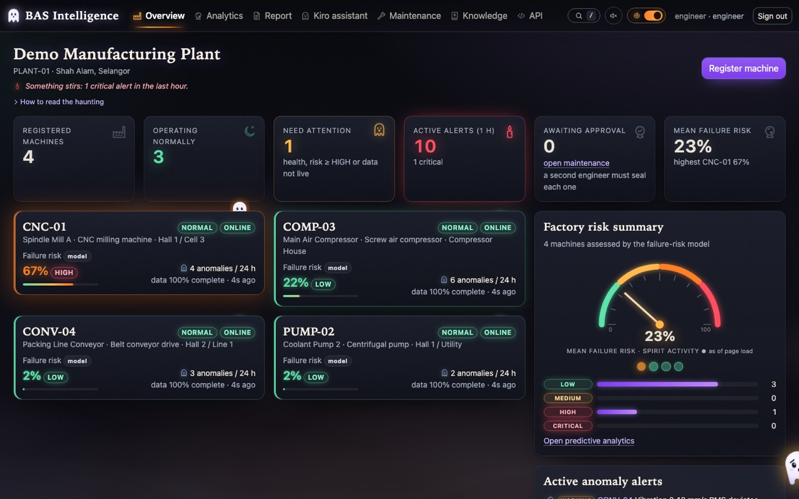
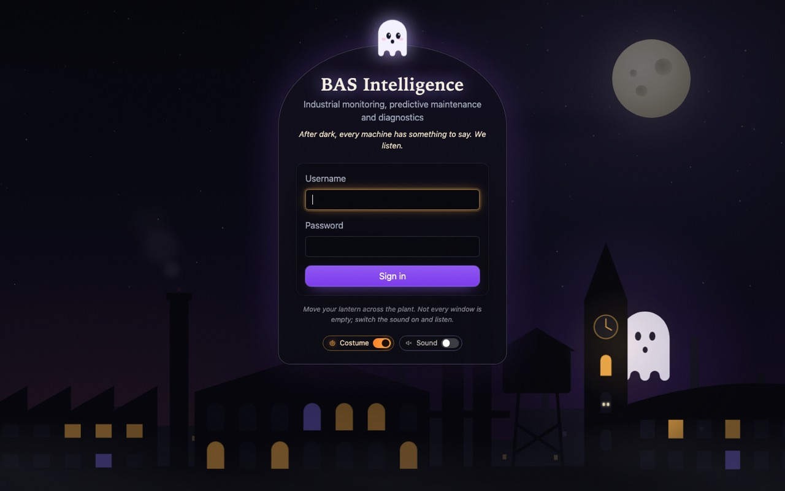

# PlantSentinel

AI-powered industrial monitoring, predictive maintenance and diagnostic assistant. It runs on an 8 GB laptop CPU
with **RM0 recurring cost**: the Spring Boot app runs locally, data lives in Neon's free PostgreSQL plan, and **Kiro**
is the reasoning agent, connected over MCP.

A factory engineer can register machines, watch telemetry, see anomalies and failure risk, inspect component images,
ask for an investigation backed by maintenance-manual evidence, approve or reject the recommendations (four-eyes
rule), and issue an incident report.

## Why

A machine rarely fails without a trail: vibration drifts, a temperature climbs, a manual already describes that pattern. Those signals usually live in different tools, and a hosted model that "explains" the failure often cannot show the chart, the prediction, or the manual page it used. It can also be asked to act on its own.

PlantSentinel keeps that trail in one place on a laptop. Detectors and risk models score the machine from its own telemetry. An investigation must cite telemetry, a model output, or a manual section. The agent can only propose a recommendation. A second engineer approves or rejects it before anyone writes a work order. The app holds no LLM API key, so the reasoning stays outside the process that stores the plant data.

## Architecture

```
Simulator / sensors ─▶ BAS / Mako Server edge (Lua) ──HTTPS + X-API-Key──▶ Spring Boot (localhost:8080)
                                                                            │  REST · validation · security
Kiro agent ──MCP (streamable HTTP, /mcp, X-API-Key)────────────────────────▶│  orchestration · audit
Browser ──form login──▶ Thymeleaf dashboard ───────────────────────────────▶│
                                                                            ├─ ML: detectors, Isolation Forest, Smile models
                                                                            ├─ Vision: OpenCV + ONNX Runtime (CPU)
                                                                            ├─ RAG: Tika + PostgreSQL full-text search
                                                                            └─ JDBC over TLS ─▶ Neon PostgreSQL (free plan)
```

Kiro replaces a hosted LLM API: instead of the app calling a model, Kiro calls the app's tools. The app stays
deterministic and testable, holds no LLM keys, and Kiro can only *propose* actions because no approve tool exists.

## Quick start

```bash
brew install openjdk@21                          # Java 21; Maven comes from ./mvnw
./mvnw spring-boot:run                           # offline demo: embedded H2, simulated plant
open http://localhost:8080                       # engineer / engineer123, reviewer / reviewer123
```

Run against Neon (free plan):

```bash
npm i -g neon && neon login
neon init -y --no-agent-setup --no-config --org-id <org> --project-id <project>   # writes .env.local
# add BAS_* secrets to .env.local (see .env.example)
SPRING_PROFILES_ACTIVE=neon ./mvnw spring-boot:run
```

Connect Kiro: copy `docs/kiro-mcp.json` to `.kiro/settings/mcp.json`, export `BAS_AGENT_API_KEY`, then run `/mcp`.
Ask: *"Why is machine CNC-01 showing a high failure risk?"* (or load the `investigate_machine` prompt).

## Public site

The public site is the demo profile. Sign in as `engineer` / `engineer123` or `reviewer` / `reviewer123`. It does not
run Kiro, and it asks for no Kiro password or API key. Reports, charts, the costume and approvals work there.

The Kiro assistant runs only on a computer where `kiro-cli login` has been completed for the person running the app.
Each message spends that Kiro account's credits. A free Kiro login is enough on that computer. A public host such as
Render's free web service cannot keep that login.

## Screens

Thymeleaf + Bootstrap, no frontend build. Every AI-derived value is labelled **measured**, **rule-based**,
**model prediction**, **documented** or **AI interpretation**.

| Screen | Path | What it shows |
|---|---|---|
| 1 Factory overview | `/` | machine counts (total, normal, needing attention), active alerts, awaiting approval, factory risk summary, recent maintenance and investigations; every tile is a link: the machine counts filter the cards (`/?machines=attention`), the others open the alert list, the pending approvals and analytics; every figure refreshes every 30 s (`/overview.json`), and a change log lists each risk, health and connectivity change and each new critical alert since the page opened |
| 2 Machine monitoring | `/machines/{code}` | details, 5 telemetry charts (2 h raw, 24 h / 7 d from 5-minute rollups), connectivity, data quality (interval, gaps, completeness, stuck sensors, edge vs simulated), historical readings |
| 3 Predictive analytics | `/analytics` | Isolation Forest scores, risk estimates and trends, risk-model performance and feature weights, per-prediction log-odds contributions, prediction history chart, versions of all models |
| 4 Report | `/reports`, `/investigations/{id}` | generate a report with the deterministic Java pipeline; the investigation page shows the evidence map, linked `[E2]` citations, tool execution trace, confidence and limitations |
| 5 Kiro assistant | `/assistant` | on a machine where Kiro CLI is signed in: a conversation for users with the Engineer role (`engineer`, `reviewer` and `admin`; not `technician` or `viewer`). Each message runs Kiro CLI there over MCP, limited to that person's machines, and shows the tool calls, the reports and the credits used. The public site does not run Kiro ([how it is secured](docs/security.md#kiro-assistant-in-the-browser)) |
| 6 Maintenance | `/maintenance` | pending approvals, recommendations, work orders with technician assignment and completion, incident reports, approval decisions and audit trail |
| 7 Knowledge | `/manuals`, `/manuals/{id}` | upload, browse, full-text search linked to exact sections, extracted sections with page numbers, which investigations cited each section |

On an investigation page every evidence item has an **open source** link: telemetry opens the machine charts,
predictions open the analytics history, and manual evidence opens the cited section of the document.

**Simulated machine incident.** On a simulated machine page, an engineer opens *Simulate a machine incident*. They
choose a fault (bearing wear, cooling degradation, pressure leak or overload) and how many minutes it takes to reach
full severity (1 to 120). From then on the machine's readings follow that fault through normal ingestion. The anomaly
detectors, health status and risk react to them. When the fault peaks, an investigation labelled *Simulated incident
SIM-n* starts by itself. Its recommendation still needs approval from a second engineer. The fault is held for 30
minutes, or until someone presses *Stop simulation*; then the normal simulation resumes. Machines fed by a real BAS
edge node cannot be simulated. API: `POST /api/machines/{code}/incidents` `{"fault":"BEARING_WEAR","rampMinutes":5}`
and `POST /api/incidents/{id}/stop`.

**Demo logins** (offline demo profile only; local defaults, never use them with a shared database). On the public site these accounts open the plant. The Kiro assistant itself answers only where Kiro CLI is signed in:

| Username | Password | Role | What it is for |
|---|---|---|---|
| `engineer` | `engineer123` | Engineer | registers machines, runs investigations, proposes and reviews recommendations; can use the Kiro assistant |
| `reviewer` | `reviewer123` | Engineer | the second engineer: approves what `engineer` or Kiro proposed (four-eyes rule); can use the Kiro assistant |
| `technician` | `technician123` | Technician | sees the machines an admin assigns, completes work orders assigned to them |
| `viewer` | `viewer123` | Viewer | read-only dashboards, investigations and reports |
| `admin` | `admin123` | Admin | everything above, including the Kiro assistant, plus Administration (users, factories, edge gateways, assignments), audit log and agent activity |

Security details: `docs/security.md`. Monitoring (Actuator, metrics, structured logs): `docs/monitoring.md`.

## The haunted costume (Kiroween, Costume Contest)

The UI comes in two costumes. **Haunted** is the default. **Daylight** is the plain Bootstrap look, one switch away:
the pumpkin switch in the navigation bar or under the sign-in form, remembered per browser. Every spooky effect
shows a value that the page also states in text, so the costume is a second way to read the same plant:





| In costume | What it shows |
|---|---|
| Aura around a machine card, meter under its risk | failure risk: green low, amber medium, orange high, red critical, grey not assessed; a stronger glow is a higher probability |
| Flicker and a ghost peeking over the card | health WARNING or CRITICAL, or failure risk HIGH or above |
| Trembling card | health or failure risk CRITICAL |
| Cobwebs and a faded card | readings are late, have stopped, or none arrived in the last hour |
| Ghost beside a count or an alert | anomalies |
| EMF meter | needle: mean failure risk; one light per machine, coloured by its risk level |
| Candle line under the plant name | red: a critical alert in the last hour; amber: a machine needs attention |
| Stone, etched, misty, parchment or ghostly evidence | measured, rule-based, model estimate, documented, AI interpretation (not verified) |
| Poltergeist, apparition, omen, grave | sensor fault, anomaly, prediction, confirmed failure |
| Wax seal | a recommendation approved by a second engineer |
| The Kiro ghost in the corner | worried when a machine's health or risk is CRITICAL, uneasy at WARNING or HIGH; its badge counts them |

The overview carries the same key under *How to read the haunting*.

**Try it in two minutes** (offline demo, `./mvnw spring-boot:run`):
1. On the sign-in page, switch **Sound** on, then move the cursor: it is a lantern. The clock tower strikes, and the
   ghosts hidden behind the tower and in dark windows sigh when the light finds them. The jack-o'-lantern beside the
   password field shows the password: its eyes are shut while the password is hidden, and it lights up while the
   password is shown (in daylight it is an eye). The gate creaks as you sign in.
2. On the overview, open *How to read the haunting*. Then open a machine, choose *Simulate a machine incident*, and go
   back: once the fault reaches the readings, the card, the counts and the change log update within 30 s, without a reload.
3. Press `/` (or Ctrl/Cmd+K) for the spirit board, an Ouija board that finds machines, pages and `INV-12`, searches
   the manuals and hands questions to the Kiro assistant. Hover an `[E2]` citation on an investigation to summon that
   evidence. Approving a recommendation seals it with wax. Type `boo` anywhere outside a text field.

**Accessibility and safety.** With `prefers-reduced-motion`, animations stop in both costumes, and
`prefers-contrast: more` removes the fog. Every control works from the keyboard, printing switches to daylight,
and small screens get a simpler layout. Sound is off until you switch it on and plays only in costume. The browser
synthesises it (Web Audio), so there are no audio files. Scripts insert page and server text with `textContent`. The
CSP allows no inline scripts. Live figures come from `/overview.json` and `/machines.json`, which are rate limited and
list only the machines the user may see.

## Built with Kiro

What `.kiro/` contains:
- **Spec** `specs/bas-intelligence/`: requirements, design and the implementation plan (92 checklist items, all done
  except the five under *Next steps*).
- **Steering** `steering/`: product, tech and structure are always included. Security is included when Kiro works on
  config, web or agent code, and haunted-costume (the rules above) when it works on templates or static files. The
  machine-investigation playbook is included on request.
- **Hooks** `hooks/`: after Kiro saves a file, they check the UI scripts' syntax (there is no frontend build), keep
  inline scripts out of the templates (the CSP would block them), and warn when an applied Flyway migration was edited.
- **Custom agents** `agents/`: `bas-investigator` for Kiro CLI, and `bas-web-assistant`, which the app starts for the
  in-browser assistant ([MCP integration](#mcp-integration)).
- **MCP**: the app is an MCP server, and Kiro investigates the plant through its nine tools (below).

## MCP integration

The same nine Spring services are reachable two ways:
1. **Ordinary tool calling** (in process): `AgentToolset` holds Spring AI `ToolCallback`s named after the Java methods
   (`getMachineStatus`, ...). Tests drive the full investigation through these callbacks.
2. **MCP** (streamable HTTP at `/mcp`): `McpToolExposure` publishes the same callbacks under namespaced names with
   titles and read-only / idempotent hints:

| MCP tool | Spring service behind it | Access |
|---|---|---|
| `machine_get_status` | MachineService, InvestigationService | read |
| `machine_get_telemetry` | TelemetryService, TelemetryRollupService | read |
| `machine_detect_anomaly` | TelemetryAnalyzer, DiagnosisEngine, InspectionService | read |
| `machine_get_failure_prediction` | RiskService, PredictionService | read |
| `machine_get_history` | InvestigationService, MaintenanceService | read |
| `machine_get_specifications` | DeviceTypeCatalog | read |
| `maintenance_search_manual` | ManualService (PostgreSQL full-text search) | read |
| `maintenance_generate_report` | InvestigationService | records an investigation |
| `maintenance_create_draft` | InvestigationService | records a PROPOSED recommendation |

The names use `namespace_action` rather than `machine.get_status`. The MCP specification allows dots, but Kiro only
accepts `^[a-zA-Z][a-zA-Z0-9_]*$` and silently drops other tools, so underscores work in every client. The server also
publishes the `investigate_machine` prompt.

Show that any MCP client can use it (app running):

```bash
./mcp/discover-tools.sh                                   # stand-alone Java MCP client (MCP SDK, no Spring)
./mcp/inspector.sh tools/list                             # official MCP Inspector CLI (Node.js)
./mcp/inspector.sh tools/call machine_get_status machineCode=CNC-01
```

Both appear as separate sessions on the admin **Agent activity** page, and every call is audited.

Kiro as the client (tested with Kiro CLI 2.36): `.kiro/agents/bas-investigator.json` declares the server and selects
`@bas-intelligence/*` (the bare `@bas-intelligence` form selected nothing in this version). Read tools and the report
are allowed, and `maintenance_create_draft` is `ask`, so Kiro needs a human yes before it writes a draft.

```bash
./mcp/kiro-demo.sh                 # Kiro investigates CNC-01; the draft is refused without approval
./mcp/kiro-demo.sh --create-draft  # resume and explicitly approve that one write
```

The **Kiro assistant** page runs Kiro from the browser with a second agent, `.kiro/agents/bas-web-assistant.json`.
It has the read tools and the report tool only, always uses Kiro's Auto model, and gets a short-lived token that limits
it to your machines. It needs Kiro CLI installed and signed in (`kiro-cli login`) for the user running the app, this
folder trusted in Kiro, and the app on port 8080. Each message spends that Kiro login's credits. The public site leaves
this switched off. Visitors are not asked to install Kiro or to bring a key.

## The agent

One agent (Kiro) and nine Java tools: `getMachineStatus`, `getSensorReadings`, `detectAnomaly`, `predictFailureRisk`,
`getHistoricalFailures`, `searchMaintenanceManual`, `getMachineSpecifications`, `generateMaintenanceReport` and
`createMaintenanceDraft`. Kiro decides which tool to call; Java validates, executes and audits every call. Every
result is labelled **measured**, **rule-based**, **model prediction**, **documented** or **AI interpretation**, and the
report keeps those sections apart.

The agent is an investigator, not an administrator. It cannot run commands, read files, see credentials, change
machine settings, control equipment or approve its own drafts. The tool allowlist, input limits, rate limit,
timeouts and audit trail are enforced in `agent/AgentToolPolicy` and `agent/AuditingToolCallback`. Only an engineer
other than the proposer can approve, which a database constraint also enforces.

Train the ML models: `ml/run-ml-lab.sh` (see [ml/README.md](ml/README.md)).

## What is where

| Area | Location |
|---|---|
| Schema (Flyway, PostgreSQL + H2) | `src/main/resources/db/migration`, `db/vendor/postgresql` |
| Streaming anomaly detection, trends | `analytics/` |
| Failure risk, stored predictions | `risk/` |
| Trained models, prediction API | `ml/`, `web/api/MlApiController` |
| ML lab (EDA, training, evaluation, export) | `mllab/`, `ml/` |
| Vision | `vision/`, `ml/build_defect_model.py` |
| Manuals and RAG | `knowledge/` |
| Investigations, approvals, reports | `investigation/`, `maintenance/` |
| Kiro MCP tools and audit | `agent/` |
| Edge (Mako Server) | `edge/` |
| Kiro spec, steering, hooks and agents | `.kiro/` |

## Tests

`./mvnw test` runs 218 unit and integration tests (see [docs/testing.md](docs/testing.md) for the test matrix and failure scenarios), including the full engineer journey, the example agent investigation through the
real tool callbacks, agent policy, security chains, ML metrics and the trained-model API. `./mvnw verify` adds PostgreSQL Testcontainers tests (requires Docker).

## Licence

This version of PlantSentinel is released under the GNU General Public License, version 2 only. The licence is the file `LICENSE`, copied verbatim from the Free Software Foundation. Its copyright notice is unchanged: Copyright (C) 1989, 1991 Free Software Foundation, Inc. No other licence is granted.

This source tree had no copyright or licence headers to remove. Dataset attribution in the model cards and in `ml/datasets/README.md` is unchanged. BAS and Mako Server are not part of this source; their copyright and licence notices stay in the [BAS repository](https://github.com/RealTimeLogic/BAS).

## BAS licensing

The [BAS repository](https://github.com/RealTimeLogic/BAS) offers GPLv2 and commercial licensing options. If you distribute a derivative BAS application, understand the GPLv2 obligations, including the treatment of application content hosted by a derivative product. For a public portfolio, keep your integration separate and review the licence before distributing a combined package.

PlantSentinel does not vendor BAS or Mako Server. `edge/build-mako-macos.sh` downloads the official sources into a local cache and builds them there. The Lua edge app in `edge/mako/bas-edge/` stays separate from those sources, and the Spring Boot application does not link against BAS.

## Free-plan safeguards

Small Hikari pool with no idle connections, background jobs that pause after 20 minutes without use (so Neon scales
to zero), 3-day raw telemetry retention with 5-minute rollups kept 90 days, stored predictions kept 90 days
(failure risk) or 30 days (ML-lab endpoints) with row limits that cap them at about 0.2 GB together, and images
stored on local disk. Neon's free plan suspends instead of billing when a limit is reached.
